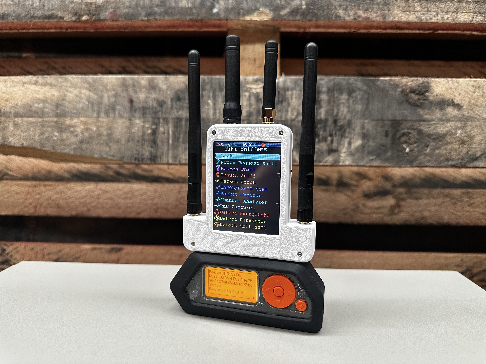
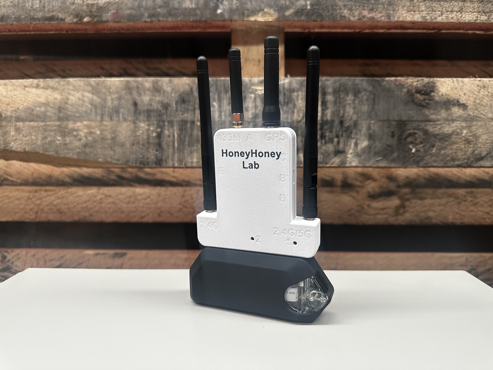
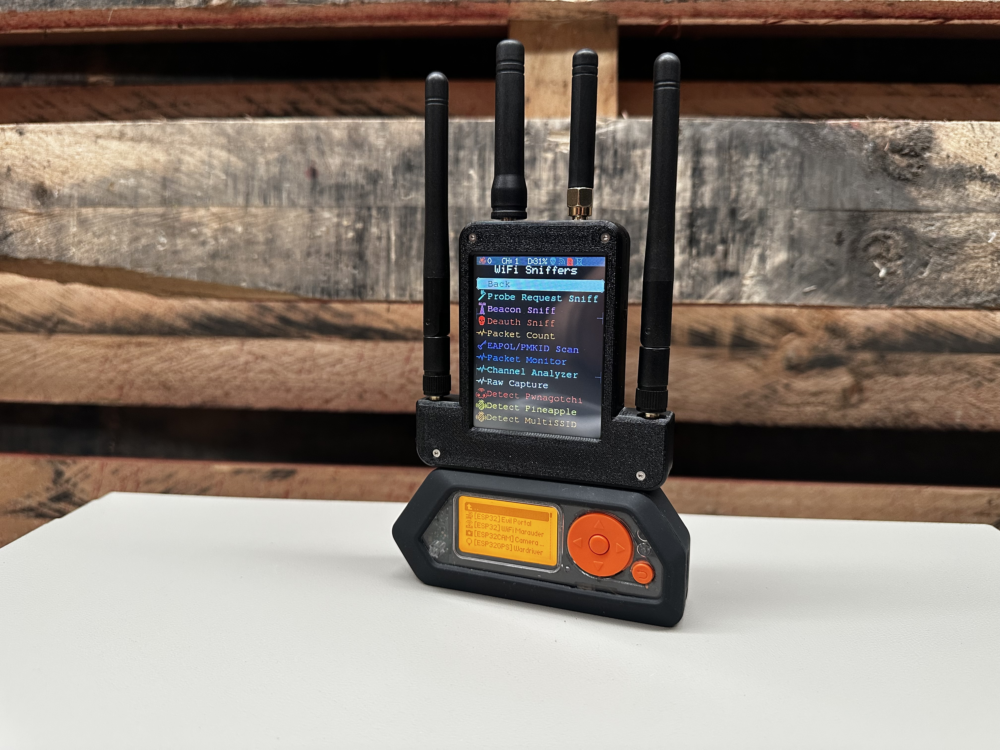
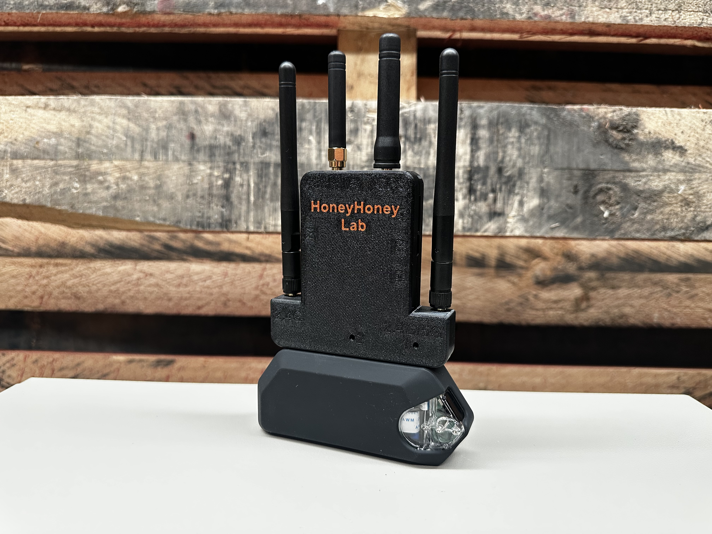
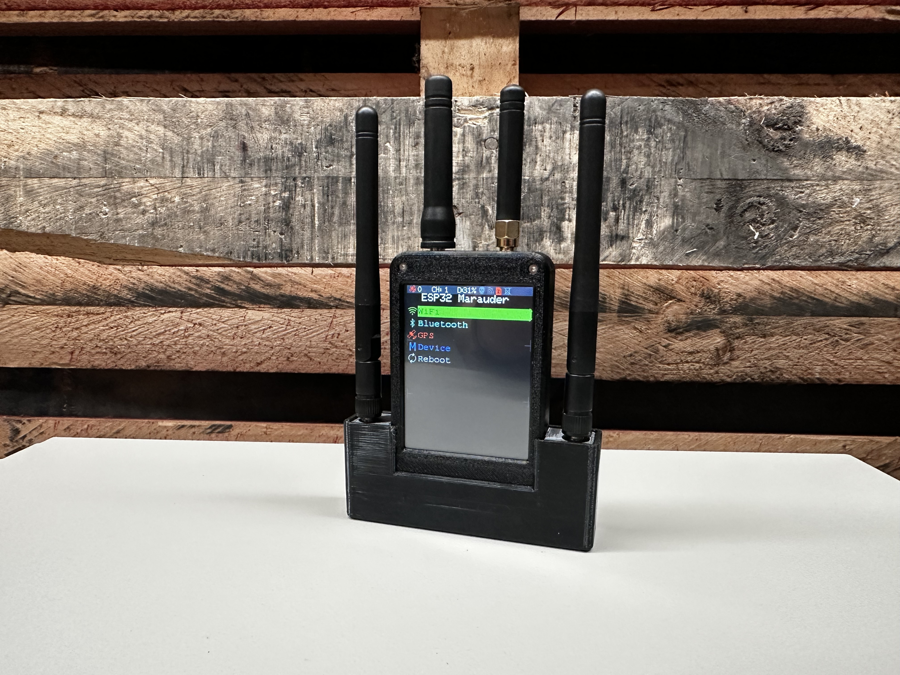
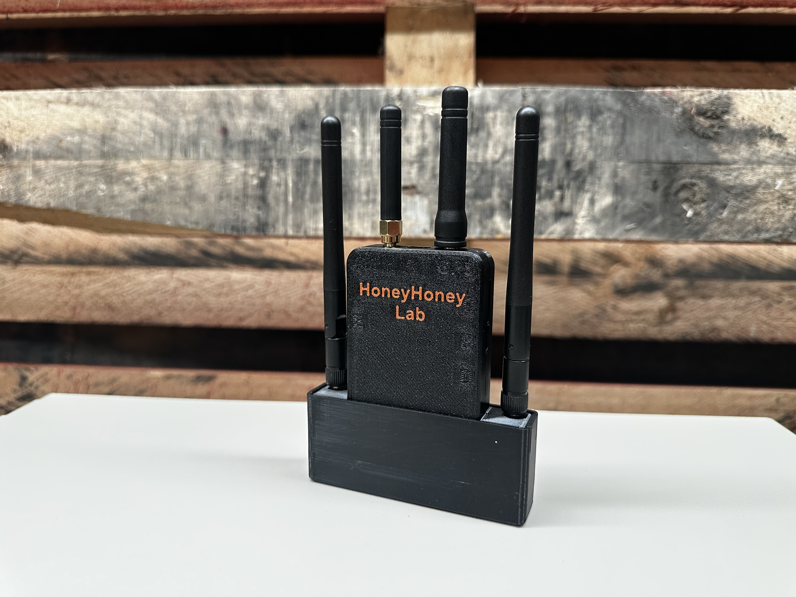
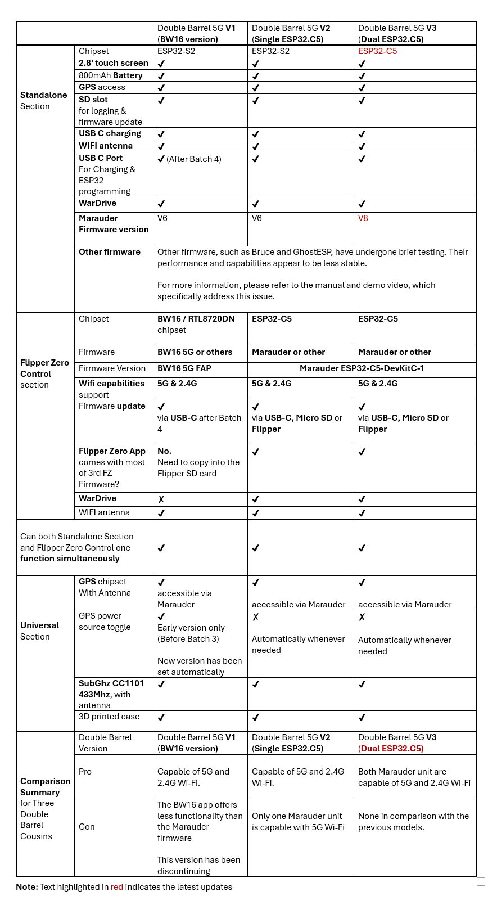
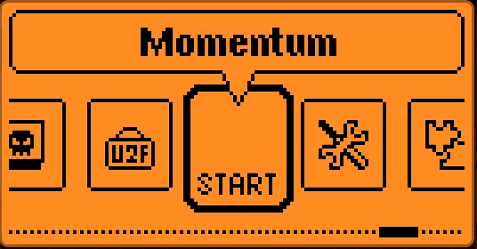
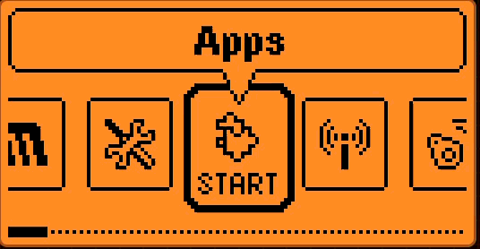

# ESP32 Marauder - Double Barrel 5G - ESP32-C5 User Manual 

> [!NOTE]
> - 04 Nov 2026 - [Double Barrel V3 has been released](https://www.tindie.com/products/honeyhoneytrading/esp32-marauder-double-barrel-5g/). The manual and video materials are currently being reorganized to provide a better reading and search experience.
> - 16 Nov 2025 - A new video guide of upgrading firmware has been added under "How to upgrade firmware via USB-C". This one is more user-friendly.  - Anson @ Honey Honey Team
> - 09 Nov 2025 - 2 * new firmware upgrade video guides, along with tools and file download links, have been added. - John @ Honey Honey Team
> - 03 Nov 2025 - 1 * update - Marauder v1.8.7 Freezes When Using a Micro SD Card — Causes and Solutions  -  Anson C. @ Honey Honey Team. 
> - 01 Nov 2025 - 2 * major updates — instructions on revising a bricked device and updating the ESP32-C5 firmware - by John @ Honey Honey Team.
> - 28 Oct 2025 - First version of this Manual - by Anson C. @ Honey Honey Team
> 
> - All procedures and descriptions related to the Flipper Zero herein were validated using Momentum Firmware, version < MNTM-010 30-04-2025 >.

 

## Double Barrel 5G V3 — Dual ESP32-C5 Marauder System 

In early 2025, we released the first version of the Double Barrel 5G, featuring the BW16 / RTL8720DN chipset. It was designed to provide Flipper Zero users with a complete, user-friendly solution for working with 5 GHz Wi-Fi. 

In September 2025, we transitioned the Double Barrel 5G V2 to the ESP32-C5 chipset, offering broader compatibility and better support for ESP32 Marauder firmware. By December 2025, the majority of Double Barrel 5G units were based on the ESP32-C5 platform. 

Now, the Double Barrel 5G has evolved to V3, introducing a significant internal upgrade: both onboard Marauder systems are now 2.4 GHz and 5 GHz Wi-Fi capable. 

For more technical details, please refer to the following comparison chart.

 

## Two Independent Marauder Systems 

The Double Barrel 5G V3 features two independent Marauder systems, both powered by the ESP32-C5-WROOM-1U-N8R8 chipset. 

- **Standalone touchscreen Marauder**: The first system features an onboard touchscreen and can operate independently, without requiring a Flipper Zero. 

- **Flipper Zero-controlled Marauder**: The second system connects to and is controlled by the Flipper Zero. 

Both systems can operate simultaneously, allowing you to run two separate Marauder tasks at the same time. This also enables dual WarDriving operations. 

The unit additionally features **onboard GPS and Sub-GHz support**, providing further functionality in a single integrated package. 

 

## Why Two Marauder Systems? 

ESP32 Marauder firmware generally operates as a linear system/firmware, meaning each device can perform only one primary task at a time. 

This limitation is the core idea behind the Double Barrel design. By integrating two independent Marauder systems into one unit, users can dedicate each system to a different task and run them concurrently, rather than having to stop one task before starting another. 

For example, one system can be dedicated to network testing while the second performs a separate monitoring or scanning task. 

## Technical specification comparison between Double Barrel models

For a detailed breakdown of the differences between hardware revisions, please refer to the comparison chart in the product listing photos and the individual user manuals. 

 

## Specification of the ESP32 Marauder Double Barrel 5G V3 

- **The Standalone Marauder comes with  :**
	- C5-WROOM-1U-N8R8 with an external antenna,
    - Onboard 8MB ram & 8MB flash version for upgarde longevity
    - Dual-Band 5Ghz + 2.4Ghz scanning, de-authentication, on multiple networks simultaneously, recommending on maximum 2 networks at the same time for optimal performance.   
	- A 2.8-inch touch screen
	- An 800mAh embedded battery
	- Onboard GPS access
	- Micro SD card slot, for updating firmware and data storage (Port C)
	- USB-C port for charging and access to ESP32 refresher (Port A)
    - WarDrive is fully functional
  	- This part of the device can funcation as a standalone device (i.e., you can use it without Flipper Zero).
   	- The hardware version of this marauder is V8

- **The Flipper Zero-controlled Marauder comes with**
  	- ESP32-C5-WROOM-1U-N8R8 with an external antenna, 
  	- Onboard 8MB ram & 8MB flash version for upgarde longevity 
  	- ESP32 fresher function has been embedded. Updating firmware can be used via USB-C port directly (Port B)
  	- Micro SD card slot, for data storage & Firmware update (Port D)
    - WarDrive is fully functional
  	- Marauder firmware version is ESP32-C5-DevKitC-1
  	
- **Others:**
 	- **CC1101 Chipset(433 MHz)**, supporting up to 10 dB output per antenna.
  	- **GPS Chipset**. GPS data is accessible to both Marauders.
  	- **WarDrive** on both Marauder units can be ran simultaneously 
  	- **Four Antennas**: 2 x 3 dB for Wi-Fi (Dual Marauder), 1 x 1 dB for GPS, and 1 x 3 dB for SubGhz 433 MHz.
  	- **Full 3D-Printed Enclosure/Case** is also included.
  	- Long term tech support via email and Whatsapp Support account

 

## Technical Guide - updating ongoing - 15.11.2026

<table>
  <tr>
    <th></th>
    <th>Double Barrel V2</th>
    <th>Double Barrel V3</th>
  </tr>
  <tr>
    <td>GPIO Setting</td>
    <td colspan="2"></td>
  </tr>
  <tr>
    <td>GPS data demo</td>
	<td colspan="2"></td>
    <td></td>
  </tr>
  <tr>
    <td>Firmware version for Touch screen Marauder (1st)</td>
    <td>V6</td>
    <td>V8</td>
  </tr>
  <tr>
    <td>Firmware Version for Flipper-control Marauder</td>
    <td colspan="2">ESP32-C5-DevKitC-1</td>

  </tr>
  <tr>
    <td>Firmware update demo via MicroSD</td>
    <td>Video Link</td>
    <td>Video Link</td>
  </tr>
  <tr>
    <td>Firmware update demo via Flash Download Tools</td>
    <td>Video Link</td>
    <td>Video Link</td>
  </tr>
  <tr>
    <td>Manual Link</td>
    <td><a href="/releases#release-V2">V2</a></td>
    <td><a href="/releases#release-V3">V3</a></td>
  </tr>
</table>

## Our official shop if you would like to support us.  
1. [ESP32 Marauder - Double Barrel 5G via Tindie](https://www.tindie.com/products/39064/)
2. [ESP32 Marauder - Double Barrel via Tindie](https://www.tindie.com/products/38768/)
3. [Our official site](https://honeyhoneylab.com/)
4. [Tindie](https://www.tindie.com/stores/honeyhoneytrading/)
5. ~~[ETSY Shop](https://www.etsy.com/au/shop/HoneyHoneyTrading)~~

 

## Warrenty and Tech Support

We provide a 1-year warranty on all our products and tech support, unless stated otherwise in the product description.

FYI, our [Etsy](https://www.etsy.com/au/shop/HoneyHoneyTrading) shop is no longer in operation. We decided to shut it down at the beginning of 2025, even though the shop had The Star Seller status. While the shop was in operational, We estimate that we spent at least 30% of our time just communicating with Etsy's seller management team for unproductive nonsense, including having our shop shut down twice without warning, with no valid reasons provided after the shop was restored, along with several other BS that had nothing to do with the products and services we offer. 

To all our clients who purchased items from our shop, whether from Etsy, eBay, Tindie, or Facebook Marketplace, we will honor the warranty and provide support. Please feel free to email us at Support@honeyhoneylab.com. or [Whatsapp](https://wa.me/61452559581) 

 

## FAQ 

## Credibility
- Credit of Marauder Firmware goes to <ins>@JustCallmeCoco</ins>
- Credit of delfyRTL goes to [gorebrau](https://github.com/gorebrau/delfyRTL)
- Credit of Bruce firmware goest to [Bruce.computer](https://bruce.computer/) 

 

## Metadata / keywords / about for bots ##
flipper zero, flipper, wifi board, marauder,5G wifi, bw16, network security, esp32, cc1101, nrf24, subghz, 2.4ghz, wifi, GPS
